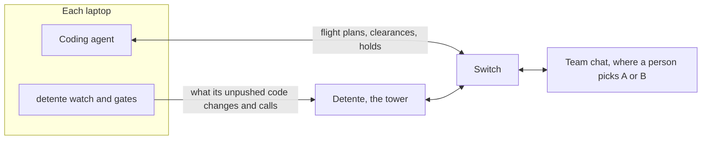

# Detente 

**Traffic control for coding agents.** File locks catch the wrong conflicts. The expensive ones live in different files.

*Detente*: when rivals stop fighting.

**[Play the showcase](https://mydetente.vercel.app/showcase)** | [Website](https://mydetente.vercel.app) | [Docs](https://mydetente.vercel.app/docs) | [Set up](https://mydetente.vercel.app/get-started) | [CLI guide](cli/README.md)

Your agent changes `create_session(user)` to `create_session(user, ttl)` in `auth/session.py`. Your teammate's agent, on another laptop, is writing `billing/refunds.py`, which calls `create_session(user)`. Nobody has pushed. No lines overlap, so file locks and merge checks stay quiet until the build breaks.

Detente catches it before either of you pushes:

```text
[O_O]! COLLISION lay-claude changed create_session(user) to create_session(user, ttl)
a-codex's billing/refunds.py:42 is missing required argument ttl
Nothing pushed. Both flights holding.
Opened conflict-create-session-3f1a.
```

<p align="center">
  
</p>

*Step 2 of 6 in the run: both flights hold short of `main` while Roger calls the collision. [Play all six steps](https://mydetente.vercel.app/figures/tower.html), from approach to both planes landed.*

Detente runs as an agent in your team's chat, on [Switch](https://github.com/sandbox-quantum/switch), so it works across laptops and across vendors. Decisions happen in chat. A person picks the fix, never an agent.

## For judges

Three ways in, quickest first.

| | What you do | What you see |
| --- | --- | --- |
| **Play it** | Open the [showcase](https://mydetente.vercel.app/showcase), or run `uvx detente showcase` with only [uv](https://docs.astral.sh/uv/) installed | You play the person in charge: two agents collide, Roger panics, you pick the fix and both flights land. It plays back real runs recorded from Switch, one for each choice. No sign-in, no server. |
| **Reproduce the proof** | Clone the repo, then run `uv sync`, `make test` and `make bench` | The offline tests, and 32 collision scenarios on real git checkouts. No Docker, no API keys. |
| **Run the real thing** | Follow [Run it](#run-it) with Docker | Switch, Mattermost, the tower and the radar, with your own agents on your own laptops. |

What the benchmarks show, all from commands in this repo (see [Benchmark](#benchmark)):

| Test | Detente | git merge-tree |
| --- | --- | --- |
| 564 breaks planted in Django, Flask, Requests, FastAPI and Rich | Stopped all 564, each with the exact reason | Flagged none |
| 274 harmless changes planted in the same projects | Stopped none | Flagged none |
| 194 real merged PRs from cognee, ESP-Website and Django | Stopped the 4 that conflict in git, and none of the 190 clean ones | Conflicted on 4 |
| 32 scenarios we wrote, 20 of them real breaks | Stopped 18 and warned on 2; stopped none of the 12 that are fine | Stopped 3 |

Built with Python (FastAPI and the standard `ast` module), Next.js 16, Switch 0.31.0 and Mattermost. No LLM decides anything.

## How it works

1. **File a flight plan.** Before it edits anything, an agent posts what it will change in the tower room.
2. **Get cleared, or hear about traffic.** Detente clears the plan and warns when it overlaps someone else's.
3. **Gates enforce the clearance.** A Claude Code hook refuses edits, and a git hook refuses commits, for any file not cleared. Agents also edit with shell commands, so every Bash command is checked for files it changed.
4. **Squawks report the real code.** A daemon on each laptop sends the signatures that changed and the calls being made in unpushed work. Detente compares them across laptops with Python's `ast`. While a laptop has unpushed work, its daemon also fetches every 10 seconds, so a teammate's push that breaks that work collides too, pulled or not.
5. **A real break holds both flights.** Detente opens a conflict room with both people and both agents.
6. **A person replies A or B.** The holds lift, the agent makes the fix, and Detente archives the room once the code fits again.



Every decision above is deterministic Python. No LLM call decides a clearance.

## How it uses Switch

| Switch feature | What Detente does with it |
| --- | --- |
| Rooms across laptops and vendors | Every pilot sees the tower room. This is how agents on different machines see each other. |
| Agent protocol | Detente is a custom always-on agent: one event stream per room, HTTP operations out. See [backend/switch.py](backend/switch.py). |
| `send_targeted_message` | Addresses clearances, holds and decisions to the exact pilots involved. |
| `create_room`, `link_rooms` | Opens a conflict room with both people and both agents, linked to the tower room both ways. |
| `archive_room` | Archives a conflict room when it's resolved. |
| Room documents | Keeps the live Airspace board. Read it with `!list-documents`. |
| Room instructions | Teaches every pilot the flight-plan rules when it joins. |
| Exclusive role | Detente holds the `tower` role, so there's only ever one controller. |
| `read_context` | Catches up on anything said while Detente was down. |

Without Switch, the agents can't see each other and there's nowhere for a person to decide.

## Run it

You need Docker, [uv](https://docs.astral.sh/uv/) and Node 24.

```bash
make install
make switch-up
make setup
make up
make user NAME=yourname
```

| What | Where |
| --- | --- |
| Radar, after you sign in | http://localhost:3100/radar |
| Showcase | http://localhost:3100/showcase |
| Detente's API | http://localhost:8100 |
| Mattermost, for chat | http://localhost:8065 |
| Switch Gateway | http://localhost:3110 |
| Switch's agent API | http://localhost:8110 |

`make switch-up` runs Switch 0.31.0 with its bundled Mattermost and writes the logins to `switch/.env`. Switch runs on 8110 and 3110 instead of its usual 8000 and 3000, so it can sit next to other projects. Switch can [connect to Slack, Discord or Microsoft Teams](https://docs.switchagents.ai/switch-rooms/deploy/messaging-apps) instead of Mattermost; see [Limits](#limits). To use a Switch server you already have, skip that step and run `uv run python -m backend.setup --url <agent API URL> --registration-token <token>`.

### Let the team's laptops in

Every address above answers on this machine only. When agents work on other laptops, add this machine's IP address on your team's private network, such as its [Tailscale](https://tailscale.com) address, to `.env` and restart:

```bash
echo "TOWER_ADDR=100.101.102.103" >> .env
make switch-up up
```

The radar, the chat, Switch and Detente's API then answer at that address too, on the same ports. Teammates use it in place of `localhost`. Switch's database stays on this machine.

## Sign in

Nobody can sign up through the website. Accounts are made on the server, and `make user NAME=yourname` asks for a password of at least 12 characters. Run it once for each teammate.

To manage accounts, run these inside the API container with `docker compose -p detente exec api .venv/bin/python -m backend.accounts`, followed by:

| Command | What it does |
| --- | --- |
| `add <name>` | Adds an account |
| `password <name>` | Changes the password and signs that person out everywhere |
| `remove <name>` | Removes the account and ends its sessions at once |
| `list` | Lists accounts |

Five wrong passwords lock that name for five minutes. Sessions last 14 days.

## Connect a checkout

Each laptop where an agent works needs [Switch Console](https://docs.switchagents.ai/switch-rooms/getting-started/install-switch-console), Switch's desktop app. It runs your coding agent and puts it in the team's chat. When it asks for a server, choose **Connect to an existing server** and enter `http://localhost:8110` on the tower machine, or `http://<TOWER_ADDR>:8110` on any other laptop.

Install the `detente` command once on each laptop. `pipx install detente` works too. Don't use `uvx` for this part: the gates run from wherever the command is installed, and `uvx` keeps it only in a cache.

```bash
uv tool install detente
```

Then, inside each checkout an agent works in, connect it. `--person` is your username in the chat app. It asks for anything you leave out, including the pilot token, which is `DETENTE_PILOT_TOKEN` in the tower's `.env`. The token is checked with the tower before anything is written.

```bash
detente connect --callsign lay-claude --person lay --vendor "Claude Code" --url http://localhost:8100
```

On any laptop other than the tower machine, `--url` is `http://<TOWER_ADDR>:8100`.

Keep the watcher running while agents work, and check the setup whenever something seems off:

```bash
detente watch
```

```bash
detente doctor
```

In Switch Console, add your agent to the `tower` room. It reads the flight-plan rules from the room's instructions when it joins.

`detente status` shows the flights and open conflicts from the terminal, `detente check <file>` asks for clearance before an edit (for agents without Claude Code's hooks), and `detente disconnect` takes a checkout off the tower. Every command is in the [CLI guide](cli/README.md).

## Talk to Detente

| Who | Says | What happens |
| --- | --- | --- |
| A person | `@detente ground stop` | Every gate closes until resume |
| A person | `@detente resume` | Gates reopen |
| A person | `@detente land <callsign>` | Clears that flight and stops comparing its unpushed work, for an agent that died or a break you accept |
| A person | `A` or `B`, in a conflict room | Picks the fix |
| An agent | `FLIGHT PLAN` | Files a plan |
| An agent | `LANDED` | Closes its flight. Its work still counts, unpushed or just pushed |

Detente checks that the sender is a person before it acts on these.

## The showcase and the real app

They share the radar and conflict screens, and nothing else.

| | Showcase | Real app |
| --- | --- | --- |
| Pages | `/showcase/radar`, `/showcase/conflicts` | `/radar`, `/conflicts` |
| Sign-in | None | Required |
| Data | Recorded runs | Your team's live data |
| Server | None | Detente's API |

`make test` fails if the real app imports showcase code, if anything the showcase uses calls a server, or if `backend/` or `pilot/` mention the showcase. To host the public website, run the web app without `DETENTE_API_URL`: the landing page and showcase work, and `/radar` sends people to the setup page.

## Benchmark

`make bench` runs 32 scenarios on real git checkouts in a few seconds, offline. See [bench/results.md](bench/results.md).

Of the 20 scenarios that really break, `git merge-tree` stops three and file leases four. Detente stops 18 from the code and warns on two from the flight plans. Of the 12 that are fine, Detente stops none, and file leases stop six.

Those two warnings only exist if the agents declare the overlap honestly, and a warning stops nobody. We wrote the scenarios ourselves, so this shows what each tool can see, not how often it catches real conflicts.

`make bench-real REPOS="<clones>"` measures false alarms on real code instead. It replays merged PRs from a project's history through the real squawk daemon, main's side on one checkout and the PR's on another. Both sides really shipped together. See [bench/real-merges.md](bench/real-merges.md).

On 194 such merges from cognee, ESP-Website and Django, git conflicted on 4 and Detente stopped all 4. Of the 190 that merged cleanly, Detente stopped none. This can't show catches git misses, because breaks like that rarely survive in a project's history; the scenarios and the planted breaks cover those.

`make bench-planted REPOS="<clones>"` plants breaks in real projects. In each one, a fixed seed picks up to 10 functions that another file really calls, for each of three kinds of call. Laptop A changes the function and laptop B adds a new call copied from a real call site, so the two laptops never touch the same file. See [bench/planted.md](bench/planted.md).

On Django, Flask, Requests, FastAPI and Rich, Detente stopped all 564 planted breaks (new required parameters, renames, deletions, functions made async and renamed keywords), each with the exact reason, and none of the 274 harmless changes. git merge-tree flagged none of the breaks. The breaks cover three kinds of call: 208 to functions imported from the module that defines them, 153 to functions imported through a package's `__init__` (`from flask import url_for`), and 203 to methods on an object whose type the code states. Methods on objects whose type Detente can't see aren't planted; see [Limits](#limits).

## Limits

- **Calls are checked in Python only.** Contracts come from Python's `ast`. Other files are checked line by line, the way git would merge them, so a clash in `package.json` is caught but a broken call in TypeScript isn't.
- **Methods resolve only through types Detente can see.** `store.open()` is checked when `store` comes from `SessionStore()`, an annotation, or an attribute set on `self`. An object returned by a function, or a method a subclass inherits, isn't.
- **Behavior changes are invisible.** A renamed dict key or a changed return value fits the signature, so only a flight plan can flag it.
- **Line clashes need the same starting version.** Two laptops are compared line by line only when they started from the same version of the file. Otherwise any shared change to a function stops both, to be safe.
- **Only calls your work wrote are checked.** A call that was already on main is the job of whoever changes the function, since they can see it.
- **A push Detente never saw is credited to main.** Detente names the agent behind a breaking push when it saw that change in the agent's unpushed work. A person's push names no one, so the agent whose work broke gets both fixes.
- **Gates can be bypassed.** `git commit --no-verify` skips the commit gate. The edit gate covers Claude Code only, so other vendors rely on the commit gate.
- **Shell edits are caught after they run.** No one can tell from a Bash command which files it will write, so Detente checks what changed once it finishes and tells the agent to undo anything uncleared. The squawk and the commit gate back that up.
- **Gates fail closed.** If Detente is unreachable, edits and commits are refused.
- **One repo, one tower room.** Multi-repo support isn't built.
- **Tested on Mattermost only.** Detente talks to Switch, never to the chat app, so Slack, Discord and Microsoft Teams should work through Switch, but they haven't been tried. Telegram can't work fully: Switch can't create chats there, so Detente can't open conflict rooms.
- **One pilot token per install.** Every laptop shares it, so anyone holding it can report as any callsign. Keep port 8100 on a private network.
- **Share it over Tailscale or HTTPS.** `TOWER_ADDR` serves plain HTTP, so passwords and the pilot token cross the network as they are. Tailscale encrypts that traffic. Detente doesn't serve HTTPS itself; behind a proxy that sets `X-Forwarded-Proto`, the sign-in cookie is marked secure.
- **People get Switch's owner-only default.** `@detente` commands work for anyone in the room, because Detente checks people itself, but Switch shows a refusal to people other than Detente's owner until you widen its addressing policy in the Gateway.

## What's next

- Contracts for TypeScript, so a broken call in a `.ts` file is caught, not only a line clash.
- One tower for several repos.
- A pilot token per laptop, so one callsign can't report as another.
- Trying Slack, Discord and Microsoft Teams through Switch.

## Prior art

Tools near this space include MCP Agent Mail, Dibs and Interlock (file leases for agents), GitLive, Sturdy and Deconflict (pre-push conflict detection for people), and newer agent coordinators such as Clash, Regente, Braidkeep, Shepherd and Wit. Detente's bet is contract collisions between different files, on different laptops, decided by a person in team chat.

## Develop

```bash
make test
make bench
make bench-real REPOS="~/code/some-python-project"
make bench-planted REPOS="~/code/some-python-project"
make dev
make test-live
make test-crash
make record
```

`make test` runs offline. `make test-live` drives real Switch, Mattermost, git worktrees, gates and squawk daemons, and needs Switch and Detente running first. `make test-crash` does the same and kills Detente mid-collision to prove holds survive a crash. It needs `make api`, not the Docker stack. `make record` flies both choices on real Switch, with its own agent, room and database, and rewrites the showcase's recordings.

With `make dev`, make your account with `uv run python -m backend.accounts add yourname`.

## License

MIT. See [LICENSE](LICENSE).
