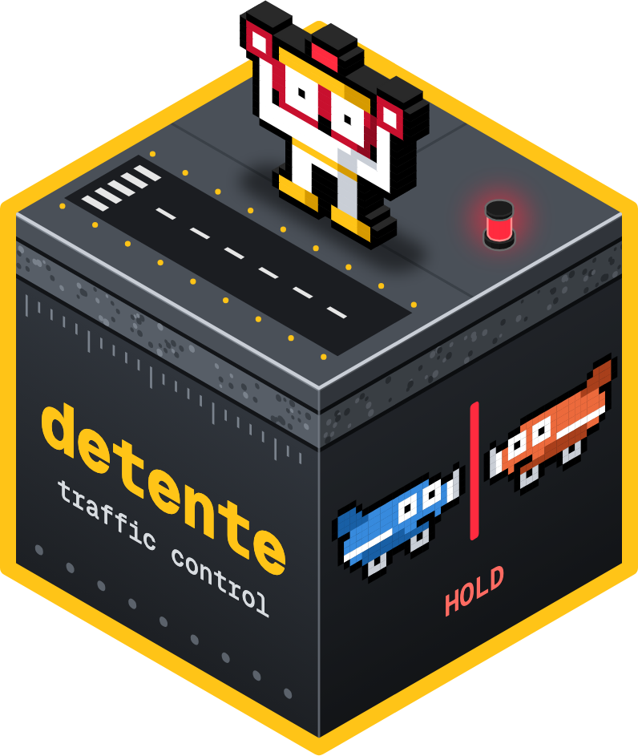
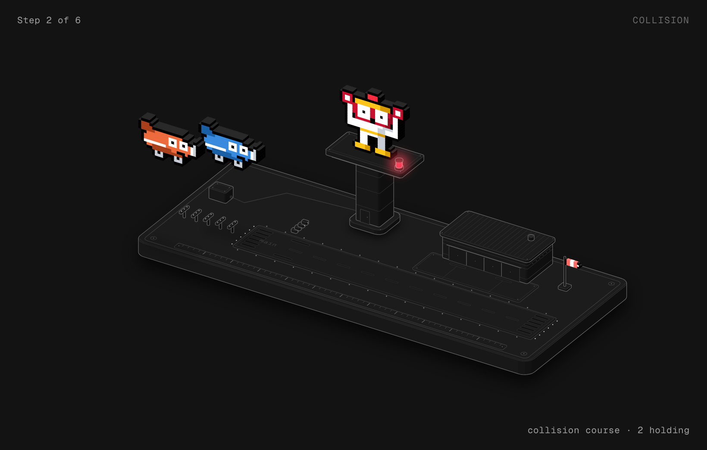
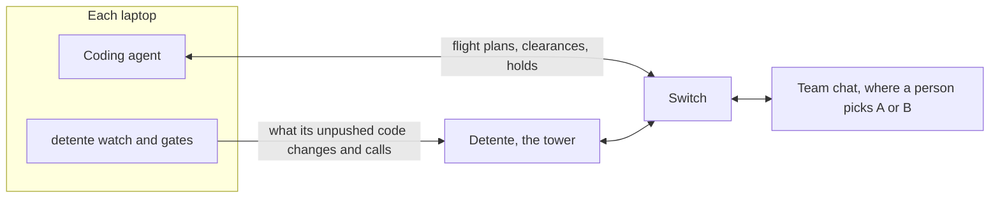

# Detente 

**Traffic control for coding agents.** Detente catches the moment one agent's change breaks code another agent is writing on another laptop, before anyone pushes.

*Detente*: when rivals stop fighting.

[](https://github.com/laypatel13/detente/actions/workflows/test.yml) [](https://pypi.org/project/detente/)    [](LICENSE)

<!-- DEMO: put the demo video link first on the line below, then the blog post, once both exist. -->
**[Play the showcase](https://mydetente.vercel.app/showcase)** | [Website](https://mydetente.vercel.app) | [Docs](https://mydetente.vercel.app/docs) | [Set up](https://mydetente.vercel.app/get-started) | [CLI guide](cli/README.md)

Built for [Flip the Switch](https://www.wemakedevs.org/hackathons/switch), Track 01: Best Business Workflow.

<!-- DEMO: put a 10 to 15 second GIF of the collision, the A/B pick and the landing here. -->


### The break that file locks miss

- **Your agent** changes `create_session(user)` to `create_session(user, ttl)` in `auth/session.py`.
- **Your teammate's agent**, on another laptop, writes `billing/refunds.py`, which calls `create_session(user)`.
- **Different files, no shared lines, nothing pushed.** File locks and merge checks stay quiet until the build breaks.

Detente catches it before either of you pushes:

```text
[O_O]! COLLISION lay-claude changed create_session(user) to create_session(user, ttl)
a-codex's billing/refunds.py:42 is missing required argument ttl
Nothing pushed. Both flights holding.
Opened conflict-create-session-3f1a.
```

<p align="center">
  
</p>

*Step 2 of 6 in the run: both flights hold short of `main` while Roger calls the collision. [Play all six steps](https://mydetente.vercel.app/figures/tower.html), from approach to both planes landed.*

### Why it's different

- **Across laptops and vendors.** Detente runs as an agent in your team's chat, on [Switch](https://github.com/sandbox-quantum/switch), so Claude Code on one laptop and Codex on another see each other.
- **It reads the code, not just the file names.** It compares the signatures each laptop changed with the calls each laptop makes, using Python's `ast`.
- **A person decides.** Both flights hold until someone replies `A` or `B` in chat. Never an agent.
- **No LLM decides anything.** Every clearance and every collision is deterministic Python.

## For judges

Three ways in, quickest first.

| | What you do | What you see |
| --- | --- | --- |
| **Play it** | Open the [showcase](https://mydetente.vercel.app/showcase), or run `uvx detente showcase` with only [uv](https://docs.astral.sh/uv/) installed | You play the person in charge: two agents collide, Roger panics, you pick the fix and both flights land. It plays back real runs recorded from Switch, one for each choice. No sign-in, no server. |
| **Reproduce the proof** | Clone the repo, then run `uv sync`, `make test` and `make bench` | The offline tests, and 32 collision scenarios on real git checkouts. No Docker, no API keys. |
| **Run the real thing** | Follow [Run it](#run-it) with Docker | Switch, Mattermost, the tower and the radar, with your own agents on your own laptops. |

What the benchmarks show, all from commands in this repo (see [Benchmark](#benchmark)):

| Test | Detente | git merge-tree |
| --- | --- | --- |
| 564 breaks planted in Django, Flask, Requests, FastAPI and Rich | Stopped all 564, each with the exact reason | Flagged none |
| 274 harmless changes planted in the same projects | Stopped none | Flagged none |
| 194 real merged PRs from cognee, ESP-Website and Django | Stopped the 4 that conflict in git, and none of the 190 clean ones | Conflicted on 4 |
| 32 scenarios we wrote, 20 of them real breaks | Stopped 18 and warned on 2; stopped none of the 12 that are fine | Stopped 3 |

What else has been run:

- **Real agents in Switch Console.** Two Claude Code agents, each in its own checkout, flew four rounds through the tower. A person picked the fix in chat both ways, `A` once and `B` once, and once the break came from a push that was already on `main`.
- **A crash in the middle of a collision.** `make test-crash` kills Detente while both flights hold. After the restart the hold is still in force and the person's pick still goes through. On every start, Detente reads what was said in the tower room while it was down, with Switch's `read_context`.
- **A clean machine, on every push.** [CI](https://github.com/laypatel13/detente/actions/workflows/test.yml) runs `make test` and `make bench` on Linux from a fresh clone.

Built with Python (FastAPI and the standard `ast` module), Next.js 16, Switch 0.31.0 and Mattermost. No LLM decides anything.

## How it works

1. **File a flight plan.** Before editing, an agent posts what it will change in the tower room.
2. **Get cleared, or hear about traffic.** Detente clears the plan, and warns when it overlaps someone else's.
3. **Gates enforce the clearance.** A Claude Code hook refuses edits and a git hook refuses commits to any file not cleared. Shell commands are checked for the files they changed.
4. **Squawks report the real code.** `detente watch` on each laptop sends the signatures its unpushed work changed and the calls it makes. It also fetches every 10 seconds, so a teammate's push that breaks this work collides too.
5. **A real break holds both flights.** Detente opens a conflict room with both people and both agents.
6. **A person replies A or B.** The holds lift, the agent makes the fix, and the room is archived once the code fits again.



Every decision above is deterministic Python. No LLM call decides a clearance.

## How it uses Switch

| Switch feature | What Detente does with it |
| --- | --- |
| Rooms across laptops and vendors | Every pilot sees the tower room. This is how agents on different machines see each other. |
| Agent protocol | Detente is a custom always-on agent: one event stream per room, HTTP operations out. See [backend/switch.py](backend/switch.py). |
| `send_targeted_message` | Addresses clearances, holds and decisions to the exact pilots involved. |
| `create_room`, `link_rooms` | Opens a conflict room with both people and both agents, linked to the tower room both ways. |
| `archive_room` | Archives a conflict room when it's resolved. |
| Room documents | Keeps the live Airspace board. Read it with `!list-documents`. |
| Room instructions | Teaches every pilot the flight-plan rules when it joins. |
| Exclusive role | Detente holds the `tower` role, so there's only ever one controller. |
| `read_context` | Catches up on anything said while Detente was down. |

Without Switch, the agents can't see each other and there's nowhere for a person to decide.

### One collision, call by call

The run from the top of this page, as it happens in chat and in [backend/tower.py](backend/tower.py).

| Step | What the room sees | What Detente calls in Switch |
| --- | --- | --- |
| 1. Detente starts | Nothing | `assume_role` takes the exclusive `tower` role. `read_context` catches up on anything said while it was down |
| 2. lay-claude joins `#tower` | The flight-plan rules | Room instructions, written once by `make setup` |
| 3. lay-claude files a plan | `FLIGHT PLAN`, then `CLEARED lay-claude · auth/session.py` | Reads the room's event stream. `send_targeted_message` answers lay-claude only |
| 4. a-codex's squawk calls the old `create_session(user)` | `COLLISION` in `#tower`, to both pilots | `send_targeted_message` to both agents |
| 5. Conflict room opens | `#conflict-create-session-3f1a` with both people, both agents and the A or B card | `create_room` with the agents, people and instructions, then `link_rooms` both ways |
| 6. A person replies `B` | `DECIDED by lay (B)` | `list_participants` checks the sender is a person, not an agent. `send_targeted_message` tells both agents |
| 7. The fixer is cleared | `CLEARED lay-claude and a-codex after conflict-create-session-3f1a` | `post_message` in `#tower`, and the Airspace board is rewritten with `update_room_document` |
| 8. The code fits again | `RESOLVED`, 0 open collisions | `archive_room` closes the conflict room |

<!-- DEMO: put a screenshot of the conflict room in Mattermost here, with the decision card and the person's reply. -->

## Run it

You need Docker, [uv](https://docs.astral.sh/uv/) and Node 24.

```bash
make install
make switch-up
make setup
make up
make user NAME=yourname
```

| What | Where |
| --- | --- |
| Radar, after you sign in | http://localhost:3100/radar |
| Showcase | http://localhost:3100/showcase |
| Detente's API | http://localhost:8100 |
| Mattermost, for chat | http://localhost:8065 |
| Switch Gateway | http://localhost:3110 |
| Switch's agent API | http://localhost:8110 |

- **`make switch-up`** runs Switch 0.31.0 with its bundled Mattermost and writes the logins to `switch/.env`.
- **Other ports.** Switch runs on 8110 and 3110 instead of its usual 8000 and 3000, so it can sit next to other projects.
- **Already have a Switch server?** Skip `make switch-up` and run `uv run python -m backend.setup --url <agent API URL> --registration-token <token>`.
- **Another chat app.** Switch can [connect to Slack, Discord or Microsoft Teams](https://docs.switchagents.ai/switch-rooms/deploy/messaging-apps) instead of Mattermost; see [Limits](#limits).

### Let the team's laptops in

Every address above answers on this machine only. For agents on other laptops, add this machine's address on your team's private network, such as its [Tailscale](https://tailscale.com) address, to `.env` and restart:

```bash
echo "TOWER_ADDR=100.101.102.103" >> .env
make switch-up up
```

The radar, the chat, Switch and Detente's API then answer at that address too, on the same ports. Teammates use it in place of `localhost`.

## Sign in

- **No sign-up page.** Accounts are made on the server: `make user NAME=yourname`, once for each teammate. It asks for a password of at least 12 characters.
- **Five wrong passwords** lock that name for five minutes. Sessions last 14 days.

<details>
<summary>Manage accounts</summary>

Run these inside the API container with `docker compose -p detente exec api .venv/bin/python -m backend.accounts`, followed by:

| Command | What it does |
| --- | --- |
| `add <name>` | Adds an account |
| `password <name>` | Changes the password and signs that person out everywhere |
| `remove <name>` | Removes the account and ends its sessions at once |
| `list` | Lists accounts |

</details>

## Connect a checkout

On each laptop where an agent works:

1. **Install [Switch Console](https://docs.switchagents.ai/switch-rooms/getting-started/install-switch-console)**, Switch's desktop app. It runs your coding agent and puts it in the team's chat. Choose **Connect to an existing server** and enter `http://localhost:8110` on the tower machine, or `http://<TOWER_ADDR>:8110` on any other laptop.
2. **Install the `detente` command** once. `pipx install detente` works too. Don't use `uvx` here: the gates run from wherever the command is installed, and `uvx` keeps it only in a cache.

   ```bash
   uv tool install detente
   ```

3. **Connect each checkout an agent works in.** It asks for anything you leave out, including the pilot token (`DETENTE_PILOT_TOKEN` in the tower's `.env`), and checks the token with the tower before it writes anything. On other laptops, `--url` is `http://<TOWER_ADDR>:8100`.

   ```bash
   detente connect --callsign lay-claude --person lay --vendor "Claude Code" --url http://localhost:8100
   ```

4. **Keep the watcher running** while agents work, and run `detente doctor` whenever something seems off.

   ```bash
   detente watch
   ```

5. **Set up the agent in Switch Console** and put it in the `tower` room:
   - **Name it exactly the `--callsign`** you gave `detente connect`. Detente knows each agent by that name.
   - **Point it at this checkout's folder**, so its edits go through this checkout's gates.
   - **Let `detente` talk to it.** Under **Who can talk to your agent**, add a rule for the agent `detente`. The default, you and your agents, blocks Detente's clearances and holds.
   - **Add it to the `tower` room.** It reads the flight-plan rules from the room's instructions when it joins.

Every command, with its options, is in the [CLI guide](cli/README.md).

## Talk to Detente

| Who | Says | What happens |
| --- | --- | --- |
| A person | `@detente ground stop` | Every gate closes until resume |
| A person | `@detente resume` | Gates reopen |
| A person | `@detente land <callsign>` | Clears that flight and stops comparing its unpushed work, for an agent that died or a break you accept |
| A person | `A` or `B`, in a conflict room | Picks the fix |
| An agent | `FLIGHT PLAN` | Files a plan |
| An agent | `LANDED` | Closes its flight. Its work still counts, unpushed or just pushed |

Detente checks that the sender is a person before it acts on these.

## The showcase and the real app

They share the radar and conflict screens, and nothing else.

| | Showcase | Real app |
| --- | --- | --- |
| Pages | `/showcase/radar`, `/showcase/conflicts` | `/radar`, `/conflicts` |
| Sign-in | None | Required |
| Data | Recorded runs | Your team's live data |
| Server | None | Detente's API |

- **Kept apart by tests.** `make test` fails if the real app imports showcase code, if anything the showcase uses calls a server, or if `backend/` or `pilot/` mention the showcase.
- **The public website** is the web app run without `DETENTE_API_URL`: the landing page and showcase work, and `/radar` sends people to the setup page.

## Benchmark

Three benchmarks, all offline, all from commands in this repo.

| Run | What it does | Result |
| --- | --- | --- |
| `make bench` | 32 scenarios we wrote, on real git checkouts, in a few seconds. 20 really break. [Results](bench/results.md) | Detente stops 18 breaks from the code and warns on 2 from the flight plans. It stops none of the 12 that are fine. `git merge-tree` stops 3 breaks. File leases stop 4, and 6 of the fine ones too. |
| `make bench-real REPOS="<clones>"` | Replays 194 merged PRs from cognee, ESP-Website and Django through the real squawk daemon: main's side on one checkout, the PR's on another. [Results](bench/real-merges.md) | git conflicted on 4 and Detente stopped all 4. Of the 190 that merged cleanly, Detente stopped none. |
| `make bench-planted REPOS="<clones>"` | Plants breaks in Django, Flask, Requests, FastAPI and Rich. Laptop A changes a function another file really calls; laptop B adds a call copied from a real call site. A fixed seed picks the functions. [Results](bench/planted.md) | Detente stopped all 564 breaks, each with the exact reason, and none of the 274 harmless changes. `git merge-tree` flagged none of the breaks. |

What they can't show:

- **The scenarios are ours.** They show what each tool can see, not how often it catches real conflicts. The 2 warnings need agents to declare the overlap honestly, and a warning stops nobody.
- **Real merges can't show catches git misses.** Breaks like that rarely survive in a project's history; the scenarios and the planted breaks cover those.
- **Planted breaks cover three kinds of call:** 208 to functions imported from where they're defined, 153 through a package's `__init__` (`from flask import url_for`), and 203 to methods on an object whose type the code states. The kinds of break are new required parameters, renames, deletions, functions made async and renamed keywords. Methods on objects whose type Detente can't see aren't planted; see [Limits](#limits).

## Troubleshooting

| What you see | What to do |
| --- | --- |
| Your agent never gets `CLEARED` | In Switch Console, check its name is exactly its `--callsign`, and that a rule under **Who can talk to your agent** lets `detente` talk to it. |
| Every edit and commit is refused | The gates fail closed when the tower is unreachable. Run `detente doctor`. |
| One file is refused as not cleared | The agent files a new flight plan that lists it. |
| No collision ever shows up | `detente watch` has to be running in each checkout an agent works in. |
| A teammate's laptop can't reach the tower | Set `TOWER_ADDR` in the tower's `.env` and restart. See [Let the team's laptops in](#let-the-teams-laptops-in). |
| Switch answers a teammate's `@detente` with a refusal | Detente still acts on it. To hide the refusal, widen Detente's addressing policy in the Switch Gateway at `http://localhost:3110`. |

## Limits

- **Calls are checked in Python only.** Contracts come from Python's `ast`. Other files are checked line by line, the way git would merge them, so a clash in `package.json` is caught but a broken call in TypeScript isn't.
- **Methods resolve only through types Detente can see.** `store.open()` is checked when `store` comes from `SessionStore()`, an annotation, or an attribute set on `self`. An object returned by a function, or a method a subclass inherits, isn't.
- **Behavior changes are invisible.** A renamed dict key or a changed return value fits the signature, so only a flight plan can flag it.
- **Line clashes need the same starting version.** Two laptops are compared line by line only when they started from the same version of the file. Otherwise any shared change to a function stops both, to be safe.
- **Only calls your work wrote are checked.** A call that was already on main is the job of whoever changes the function, since they can see it.
- **A push Detente never saw is credited to main.** Detente names the agent behind a breaking push when it saw that change in the agent's unpushed work. A person's push names no one, so the agent whose work broke gets both fixes.
- **Gates can be bypassed.** `git commit --no-verify` skips the commit gate. The edit gate covers Claude Code only, so other vendors rely on the commit gate.
- **Shell edits are caught after they run.** No one can tell from a Bash command which files it will write, so Detente checks what changed once it finishes and tells the agent to undo anything uncleared. The squawk and the commit gate back that up.
- **Gates fail closed.** If Detente is unreachable, edits and commits are refused.
- **One repo, one tower room.** Multi-repo support isn't built.
- **Tested on Mattermost only.** Detente talks to Switch, never to the chat app, so Slack, Discord and Microsoft Teams should work through Switch, but they haven't been tried. Telegram can't work fully: Switch can't create chats there, so Detente can't open conflict rooms.
- **One pilot token per install.** Every laptop shares it, so anyone holding it can report as any callsign. Keep port 8100 on a private network.
- **Share it over Tailscale or HTTPS.** `TOWER_ADDR` serves plain HTTP, so passwords and the pilot token cross the network as they are. Tailscale encrypts that traffic. Detente doesn't serve HTTPS itself; behind a proxy that sets `X-Forwarded-Proto`, the sign-in cookie is marked secure.
- **People get Switch's owner-only default.** `@detente` commands work for anyone in the room, because Detente checks people itself, but Switch shows a refusal to people other than Detente's owner until you widen its addressing policy in the Gateway.

## What's next

- Contracts for TypeScript, so a broken call in a `.ts` file is caught, not only a line clash.
- One tower for several repos.
- A pilot token per laptop, so one callsign can't report as another.
- Trying Slack, Discord and Microsoft Teams through Switch.

## Prior art

Tools near this space include MCP Agent Mail, Dibs and Interlock (file leases for agents), GitLive, Sturdy and Deconflict (pre-push conflict detection for people), and newer agent coordinators such as Clash, Regente, Braidkeep, Shepherd and Wit. Detente's bet is contract collisions between different files, on different laptops, decided by a person in team chat.

## Develop

| Command | What it does |
| --- | --- |
| `make test` | The tests, offline |
| `make bench` | The 32 scenarios |
| `make bench-real REPOS="~/code/some-python-project"` | Replays a project's merged PRs |
| `make bench-planted REPOS="~/code/some-python-project"` | Plants breaks in a project |
| `make dev` | The API and web app with reloading. Make your account with `uv run python -m backend.accounts add yourname` |
| `make test-live` | Drives real Switch, Mattermost, git worktrees, gates and squawk daemons. Needs Switch and Detente running. Each run leaves two test agents in your `tower` room |
| `make test-crash` | The same, and kills Detente mid-collision to prove holds survive a crash. Needs `make api`, not the Docker stack |
| `make record` | Flies both choices on real Switch, with its own agent, room and database, and rewrites the showcase's recordings |

## How this was built

Built by Lay ([laypatel13](https://github.com/laypatel13)) during Flip the Switch, from the first commit on November 4, with Claude Code as a coding assistant. Every number in this README comes from a command in this repo, so you can rerun it instead of taking it on trust.

## License

MIT. See [LICENSE](LICENSE).
