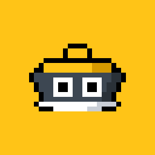
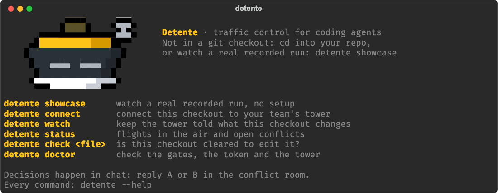
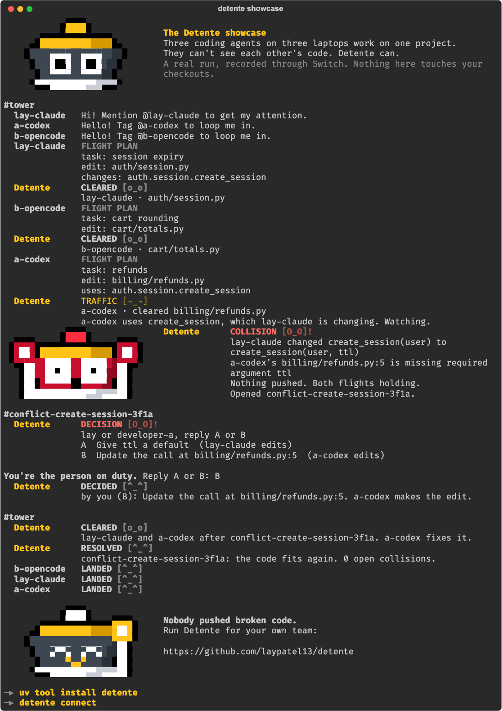
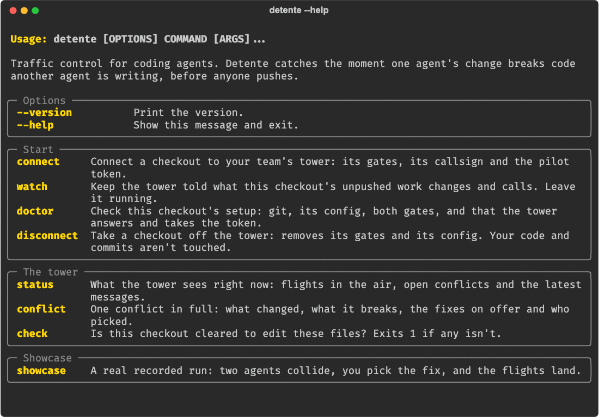
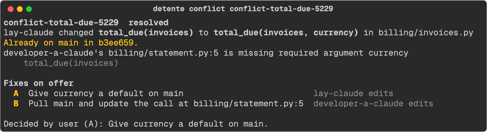

<p align="center">
  
</p>

<h1 align="center">The Detente CLI</h1>

<p align="center">
  <b>Traffic control for coding agents.</b> Connect each checkout to your team's tower,<br>
  and Detente catches the moment one agent's change breaks code another agent is writing, before anyone pushes.
</p>

<p align="center">
  
</p>

---

## Install

You need Python 3.12 or newer.

```sh
uv tool install detente
```

`pipx install detente` works too. Install it rather than running it with `uvx` before you connect a checkout:
the gates run from wherever the command is installed, and `uvx` keeps it only in a cache.

Or try the showcase without installing anything:

```sh
uvx detente showcase
```

## See it first: the showcase

A real run, recorded through Switch. Three coding agents on three laptops work on one project. One changes
`create_session(user)` to `create_session(user, ttl)` while another writes code that calls it the old way. No
lines overlap, so file locks and merge checks stay quiet. Detente holds both flights, opens a conflict room, and
you pick the fix. No tower, no setup, and it never touches your checkouts.

```sh
detente showcase
```

<p align="center">
  
</p>

## Connect a laptop

Someone on your team runs the tower first: Switch and Detente, with the
[setup guide](https://github.com/laypatel13/detente#run-it). Then, in each checkout an agent works in:

**1.** Connect it. It asks for anything you leave out, and checks the pilot token with the tower before it writes
anything:

```sh
detente connect --callsign lay-claude --person lay --vendor "Claude Code" --url http://localhost:8100
```

`--url` is `http://localhost:8100` on the tower machine. From any other laptop it's port 8100 at the tower's
`TOWER_ADDR`, once the tower [lets the team's laptops in](https://github.com/laypatel13/detente#let-the-teams-laptops-in).
`--callsign` is the agent's name in Switch and `--person` is your username in the chat app. The pilot token is
`DETENTE_PILOT_TOKEN` in the tower's `.env`. It's asked for rather than typed on the command line, so it stays out
of your shell history (or set `DETENTE_TOKEN`).

**2.** Keep the watcher running while agents work:

```sh
detente watch
```

**3.** Add the agent to the `tower` room in Switch. It learns the flight-plan rules from the room.

**4.** Check that it's all wired up:

```sh
detente doctor
```

## Every command

<p align="center">
  
</p>

#### Start

| Command | What it does |
|---|---|
| `detente` | Roger, where you are, and the commands you'll use most. |
| `detente connect` | Connects the checkout you're in to your team's tower: the commit gate, Claude Code's edit gate, the callsign and the pilot token. |
| `detente watch` | Tells the tower what this checkout's unpushed work changes and calls. While there's unpushed work it also fetches main every 10 seconds, so a teammate's push that breaks it collides too. Ctrl+C stops it. |
| `detente doctor` | Checks git, the config, both gates (and that they still point at a Python that exists), and that the tower answers and takes the token. |
| `detente disconnect` | Removes this checkout's gates and config. Anyone else's hooks, your code and your commits stay as they are. |

#### The tower

| Command | What it does |
|---|---|
| `detente status` | Flights in the air, open conflicts and the latest messages. `-n 10` shows more messages. |
| `detente conflict [name]` | One conflict in full: what changed, what it breaks, the fixes on offer and who picked. Leave the name out for the open one. |
| `detente check <file>…` | Is this checkout cleared to edit these files? Exits 1 if any isn't. For agents that don't run Claude Code's hooks, and for scripts. |

<p align="center">
  
</p>

#### Showcase

| Command | What it does |
|---|---|
| `detente showcase` | The recorded run. `--fast` plays it without pauses. |

#### Options

| Option | What it does |
|---|---|
| `--repo PATH`, `-r PATH` | Use another checkout than the one you're in. |
| `--json` | The raw result as JSON, for scripts (`doctor`, `status`, `conflict`, `check`). |

Exit codes: `0` all fine, `1` a finding (`check` refused a file), `2` a usage problem, `3` the setup or the tower
(`doctor` found a problem, or the tower didn't answer).

## Decisions happen in chat

The CLI connects checkouts and reads the tower. It never picks a fix. Decisions happen in Switch, where both people
and both agents see them:

| Who | Says, in chat | What happens |
|---|---|---|
| A person | `A` or `B`, in a conflict room | Picks the fix |
| A person | `@detente ground stop` | Every gate closes until resume |
| A person | `@detente resume` | Gates reopen |
| A person | `@detente land <callsign>` | Clears that flight, for an agent that died or a break you accept |

## What goes where

- `detente connect` writes `.detente` into the checkout: the callsign, the tower's address and the pilot token. It
  keeps that file out of git with the checkout's own `.git/info/exclude`, so it's never committed.
- `detente watch` sends your tower the paths your unpushed work touched, which lines changed, the signatures of
  the functions it changed, and each call's file, line and text. Never whole files.
- The gates send the tower only the paths of the files being edited or committed.
- Everything goes to the tower address you gave, and nowhere else. The CLI sends no telemetry.

## Uninstall

Take each checkout off the tower:

```sh
detente disconnect
```

Then remove the command:

```sh
uv tool uninstall detente
```

---

<p align="center">
  Part of <a href="https://github.com/laypatel13/detente">Detente</a> · MIT license ·
  <i>When rivals stop fighting.</i>
</p>
